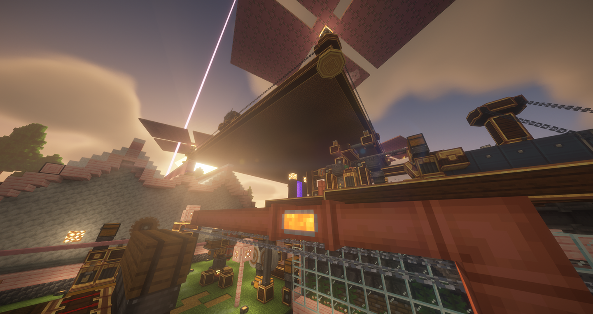
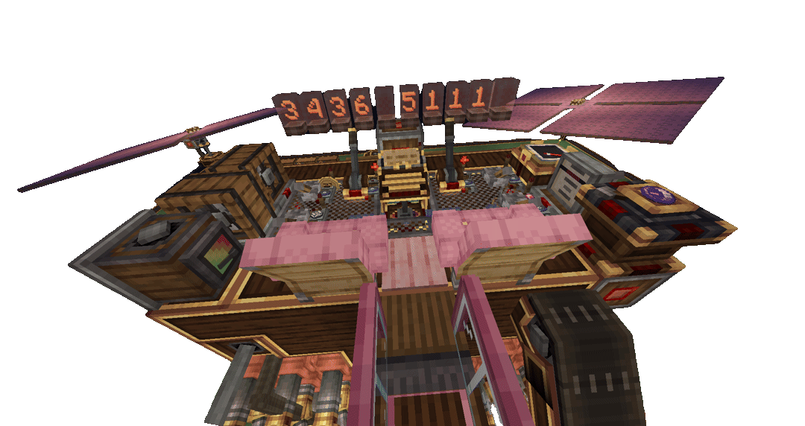
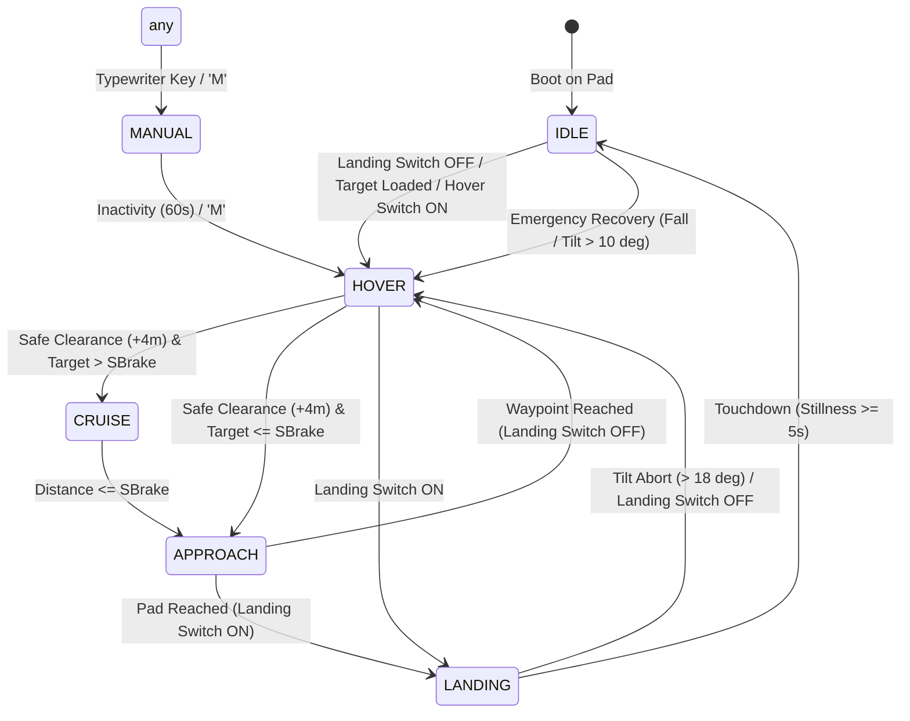
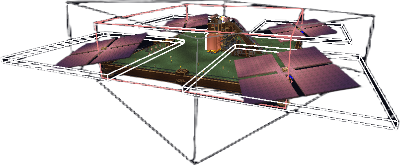

# Quadrocopter — CC: Tweaked / Create Aeronautics

An advanced, fully autonomous flight controller and autopilot for CC: Tweaked and Create Aeronautics, turning a 42×42 flying platform into a high-speed vector-thrust aircraft with real-time waypoint navigation, automated soft landing, cabin relay controls, wireless joystick dialing, and biometric cryptographic security.

    

## What It Does

Quadrocopter transforms a massive airborne contraption into a stable, pilotable vessel. The computer orchestrates all onboard flight dynamics: measuring altitude, 3D velocity, Euler attitudes, and atmospheric pressure across a multi-sensor array. It drives cascade transmissions for precision propeller rpm, vectors thrust in real time via gyroscopic propeller bearings, holds station in hover with micro-damping, cruises at maximum aerodynamic speeds toward navigation compasses or dialed coordinates, and executes smooth Flare-assisted touchdowns on landing pads.

## Features

**Line-of-Sight Vector Navigation** — flights are calculated along direct 3D visual lines of sight ($D_{\text{horiz}}$ and relative bearing) derived from the navigation table. Sensors damp lateral drift and forward inertia, while the vessel steers directly toward the target without relying on dead-reckoning accumulation.

**Cascade Transmission Drivetrain** — dynamic integration of multiple `analog_transmission` peripherals cascading in series ($R_{\text{total}} = \prod \frac{15 - s_i}{15}$). A two-stage cascade provides 75 distinct gear steps, while a three-stage cascade unlocks 4,096 gear states (~0.03% throttle granularity), eliminating discrete step oscillations and providing butter-smooth hover stabilization.

**True Gyroscopic Vectoring** — automated thrust vectoring with up to 12.0° bearing cone authority. In cruise, bearings tilt forward to achieve high horizontal velocity while Aeroworks platform gyroscopes soften dynamically. In hover and approach, gyroscopes stiffen to keep the platform level.

**Kinetic Overstress Governor** — real-time monitoring of drivetrain stress via `isOverstressed()`. If kinetic limits are approached, the governor instantly trims throttle ceiling and sheds torque load, preventing mid-air engine stalls.

**Kinematic Flare Landing** — automated parabolic descent curve that cushions landing shock as the ground approaches. Touchdown memory records pad elevation for subsequent precision returns, while steep-slope abort triggers hover recovery (+2.0m obstacle buffer) if surface tilt exceeds 18.0°, transitioning to parked `IDLE` upon resting motionless ($\le 0.05$ m/s) for 5 seconds.

**Station Hold & Altitude Floor** — rock-solid station-keeping within a 4.0-meter deadband using soft 1.8° damping vectors to eliminate pendulum swaying. A dedicated analog cabin lever sets the cruise altitude floor anywhere from 64 to 320 blocks.

**Cockpit Relay Controls** — all physical cockpit switches and analog levers (Altitude, Speed/Thrust Limiter, Landing, Hover Station, Horizon Lock, Security Lock) route through networked `redstone_relay` peripherals, calibrated interactively with step-by-step flashing prompts on Create Nixie Tubes. In flight, the Nixie line runs a continuous multi-phase annunciator loop (1s target name or coordinates, 3s distance and ETA, 1s airspeed or approach status).

**Wireless 2D Joystick Dialing** — an off-board or cockpit wireless 2D joystick (5 channels via Redstone Links) allows dialing target coordinates on the fly while cruising. Dynamic rate integration lets you enter coordinates anywhere from $\pm 10$ to $\pm 999.9\text{k}$ blocks in seconds, while centering and clicking confirms or cancels destination.

**Cryptographic Access Control** — multi-vector directional gesture PIN authenticated via salted cryptographic hash. When armed, physical controls, keyboards, and terminals are isolated from the flight loop. Unlocking requires entering the secret sequence with the 2D joystick.

**State & Target Persistence** — all active control positions, flight modes, and manual navigation coordinates are automatically preserved in `quadrocopter.cfg`. Reboots while locked under password seamlessly restore exact flight altitude, hover mode, and destination without dropping out of the sky.

**Linked Typewriter Manual Override** — full cockpit manual flight control via an onboard `linked_typewriter`. Pressing `M` toggles manual flight mode, while standard flight keys (W/A/S/D/Space/Shift/Alt) grant instant physical takeover with live airspeed and roll telemetry displayed on Nixie tubes.

## Setup

1. Assemble the 42×42 flying platform with 4 corner 17×17 sail propellers mounted on `gyroscopic_propeller_bearing` blocks driven by a shared kinetic driveshaft equipped with a reversing `Gearshift` mechanism for emergency deceleration and UNJAM cycles.
2. Install the sensor package: 1× `altitude_sensor`, 2× `velocity_sensor` (local X and Z axes), 1× `gimbal_sensor`, 2× `navigation_table` (one for target Lodestone compass, one for World Spawn reference GPS), and an optional `Create_NixieTube` display line.
3. Place a CC: Tweaked Advanced Computer connected via a bottom Wired Modem to the contraption's peripheral network.
4. Wire the cockpit controls using `redstone_relay` peripherals:
   - **Relay 1**: Cruise Altitude lever, Landing switch, Hover Station switch.
   - **Relay 2**: Speed/Thrust Limiter lever, Horizon Lock switch, Master Security Lock switch, with Gyro X (left) and Gyro Z (right) analog outputs.
   - **Relay 3**: Dedicated Wireless Joystick relay with 5 Redstone Link channels (Forward, Right, Backward, Left, and Accept button).
5. Copy `quadrocopter.lua` and `startup.lua` to the computer.
6. On initial boot, run the interactive calibration wizard (`C` key) to bind all relay faces and set your security PIN.

    

## Configuration

### quadrocopter.cfg

The flight controller automatically manages `quadrocopter.cfg` in native ComputerCraft serialization format. It stores:

- `cabin_bindings` — hardware mappings of all relay names and faces for cockpit levers and switches.
- `joystick_bindings` — relay name and face channels for the 5-way wireless joystick.
- `security` — salted hash and step count for the joystick access PIN.
- `landing_memory` — persistent elevation database indexing landing pads by compass/waypoint IDs.
- `last_controls` — persistent snapshot of active altitude, speed limit, landing, hover, and deck horizon states across computer and chunk reloads.
- `saved_target` — persistent coordinates for manual waypoint destinations.

Manual editing of `quadrocopter.cfg` is not required.

## Controls

The vessel can be operated through physical cockpit levers, the wireless 2D joystick, the physical `linked_typewriter` keyboard, or terminal hotkeys.

| Control | Type | Channel / Key | Function |
| :--- | :--- | :--- | :--- |
| **Cruise Altitude** | Analog Lever | Relay Face (0–15) | Sets cruise and hover altitude floor (64m to 320m) |
| **Speed / Thrust** | Analog Lever | Relay Face (0–15) | Limits horizontal thrust and bearing cone angle (1.0° to 12.0°) |
| **Landing Mode** | Switch | Relay Face (ON/OFF) | ON = descend and park in IDLE; OFF = liftoff into HOVER |
| **Hover Station** | Switch | Relay Face (ON/OFF) | Holds stationary hover at commanded altitude |
| **Horizon Lock** | Switch | Relay Face (ON/OFF) | Locks platform deck at 0° tilt during cruise for walking stability |
| **Security Lock** | Switch | Relay Face (ON/OFF) | Locks all controls and masks password prompts |
| **2D Joystick** | Wireless Stick | Redstone Links (5ch) | Dials X/Z waypoint coordinates; enters directional PIN |
| **Joystick Accept** | Button | Torch Redstone Link | Confirms dialed coordinates (or cancels if `0 0`); submits PIN steps |
| **Manual Override** | Typewriter | `M` | Toggles manual flight mode |
| **Flight Controls** | Typewriter | `W` / `A` / `S` / `D` | Manual pitch and roll translation |
| **Vertical Flight** | Typewriter | `Space` / `Left Shift` | Manual climb and descent |
| **Reverse Thrust** | Typewriter | `Left Alt` | Engages drivetrain reverse gearbox |
| **Engine Cutoff** | Typewriter | `Backspace` | Emergency engine cutoff into IDLE |
| **Level to Floor** | Typewriter | `H` | Centers vectors and levels craft to floor altitude |
| **Begin Landing** | Typewriter | `L` | Initiates flare descent sequence |
| **Calibration** | Terminal | `C` | Re-runs interactive Nixie/terminal calibration wizard |
| **Change PIN** | Terminal | `P` | Re-configures joystick security password |

### Cockpit Levers & Switches

- **Altitude Lever**: Adjusting the lever updates the commanded cruise altitude in real time. If the craft is parked in `IDLE`, toggling the landing switch off causes the craft to take off and climb directly to this target altitude.
- **Speed Limiter Lever**: Lowering the lever (increasing signal from 0 to 15) increases allowed horizontal thrust and bearing cone authority from 1.0° up to 12.0°. At maximum (15/15), the ship accelerates freely with full aerodynamic power.
- **Landing Switch**: Flipping to ON initiates deceleration and descent to the pad. Once motionless on the ground for 5 seconds at $\le 0.05$ m/s, engines cut to `IDLE`. Flipping to OFF initiates immediate liftoff into `HOVER`.

### Wireless 2D Joystick

- **Coordinate Dialing**: Moving the stick in flight opens coordinate entry mode without interrupting autopilot progress. Stick deflection integrates coordinates non-linearly (from single blocks up to $\pm 999.9\text{k}$). Centering the stick starts a 5-second countdown. Pressing the center button confirms coordinates and dispatches the ship.
- **Target Cancellation**: Pressing the center button while coordinates read `0 0` cancels the active target and transitions the craft into stationary `HOVER`.
- **Security PIN**: When the security lock switch is disengaged while locked, deflect the stick in the secret directions, clicking the button after each step to unlock the vessel.

## Flight Modes

1. **IDLE** — Vessel safely parked on the ground with engines completely disengaged (0% throttle). Active safety watchdogs monitor attitude and vertical speed: any inadvertent fall ($V_y < -0.15$ m/s) or steep tilt ($> 10.0^\circ$) immediately aborts `IDLE` and engages rescue hover power.
2. **HOVER** — Pure vertical ascent, descent, and station hold with bearings vertical $(0, 1, 0)$ and rigid gyroscopes. Holds assigned cruise altitude while dampening drift within a 4-meter deadband.
3. **CRUISE** — Full-speed transit toward the destination waypoint with bearings tilted up to the limit set by the Speed lever (up to 12.0°) and platform gyroscopes softened for maximum airspeed.
4. **APPROACH** — Kinematic parabolic deceleration curve ($v = \sqrt{2 a \Delta s}$) that smoothly bleeds off cruise momentum prior to arrival over the pad.
5. **LANDING** — Flare-assisted descent that dynamically computes target vertical speed as elevation shrinks. Preserves baseline level horizon with an 18.0° abort envelope that lifts into `HOVER` with a +2.0m clearance if an obstacle is struck, and transitions to `IDLE` upon confirmed stillness on the ground ($\le 0.05$ m/s for 5.0 seconds at $\le 25.0^\circ$ tilt).
6. **MANUAL** — Direct pilot control via the cockpit `linked_typewriter`. Autopilot yields instantly upon any keystroke and resumes hover hold after 60 seconds of inactivity.
7. **UNJAM** — Automated transmission unjamming routine that cycles reverse gearshifts to clear drivetrain kinetic stalls.

## Architecture

    

The controller runs on a 20 Hz tick loop (`CONFIG.TICK_RATE = 0.05s`). It combines multiple independent control systems:

- **Attitude & Kinematics**: Local contraption velocities ($V_x$ lateral, $V_z$ forward) and vertical rates are processed by tuned PID regulators to modulate transmission gear signals and bearing 3D orientation vectors, with parabolic deceleration ($V_{\text{target}} = \sqrt{2 a_{\text{brake}} D_{\text{horiz}}}$) during approach.
- **Inverted Bearing Geometry**: Seamlessly handles Create: Avionics inverted polarities where clockwise starboard bearings return negative angles, requiring an explicit negative sign ($\text{localX} = -D_{\text{horiz}} \cdot \sin(\beta)$) to prevent violent lateral divergence away from targets.
- **Atmospheric Compensation**: Reads barometric pressure from the altitude sensor to dynamically scale vector cones ($\alpha_{\text{max}}$) in thin upper atmosphere while automatically boosting drivetrain throttle ($U / \cos(\alpha)$) to counteract lift loss during forward tilt.
- **Peripheral Bus Safety**: All peripheral calls cache state changes to eliminate redundant network writes and prevent server tick yields.
